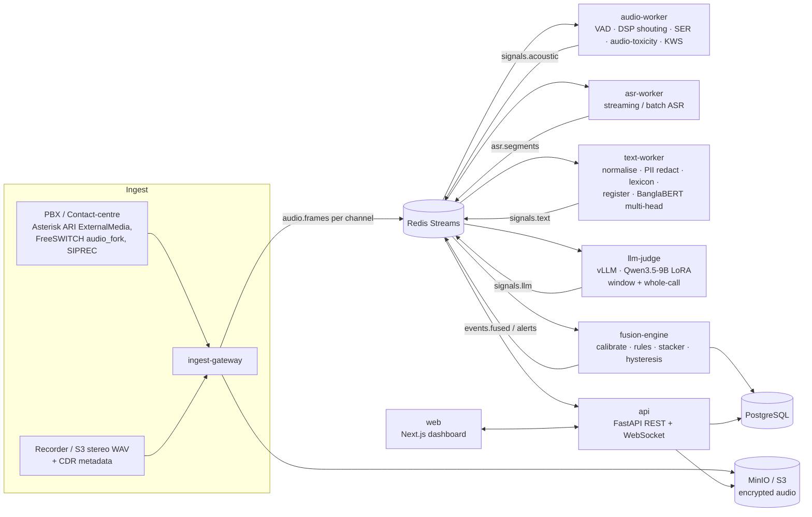

# 01 — System Architecture

GAL-E = **G**ali & **A**ggression **L**istening **E**ngine.
Detects Bangla slang/gali, abusive and negative language, harsh behaviour, disrespectful register and shouting in Bangladeshi call-centre calls — **per speaker (agent vs customer)** — in two modes:

- **Post-call QA mode** (batch, built first): every call scored, full-context LLM review, QA scorecard.
- **Real-time mode** (streaming): supervisor alerts within seconds for high-confidence events.

Both modes share the same models and the same fusion logic; only the transport differs.

---

## 1. High-level data flow



### Why this shape
- **Per-channel processing.** Stereo (agent L / customer R) is the default; diarization (pyannote community-1) is only a fallback for mono recordings.
- **Fast path never waits for the slow path.** Lexicon, KWS, DSP and the encoder classifier raise provisional events in < 1.5 s; the LLM confirms, downgrades or adds context-only events (sarcasm, threats without swear words) a few seconds later.
- **Everything is a signal with a calibrated probability** → the fusion engine is the only place that decides what becomes an alert. Thresholds are config, not code.

---

## 2. Components

| Service | Responsibility | Tech | Scales on |
|---|---|---|---|
| `ingest-gateway` | Receive RTP/WebSocket/SIPREC streams or recording files; decode G.711 µ-law/A-law, AMR-NB; split channels; resample to 16 kHz mono float32 per channel; write raw audio to S3; publish `audio.frames` (20 ms frames batched to 200 ms) and `call.lifecycle` events | Python asyncio, `aiortc`/raw RTP, `soundfile`, `soxr`; ARI client for Asterisk | concurrent calls (CPU) |
| `audio-worker` | Silero VAD; per-speaker loudness/F0/tilt features + shouting classifier; emotion2vec+ fine-tuned SER (angry/frustrated/neutral + arousal); audio-toxicity head; KWS (CTC keyword search + dedicated KWS model) | PyTorch / ONNX Runtime GPU, `pyworld` or `torchcrepe` for F0, LightGBM | GPU |
| `asr-worker` | Pluggable `ASRBackend`: `whisper_ct2` (faster-whisper / WhisperLiveKit SimulStreaming), `indic_conformer` (NeMo, streaming CTC/RNN-T), `qwen3_asr` (vLLM). Emits partial + final segments with word timestamps and confidences; exposes CTC posteriors to KWS when backend supports it | CTranslate2, NeMo, vLLM | GPU |
| `text-worker` | Unicode NFC + Bangla normalisation; number/abbrev normalisation; PII redaction (regex + NER) → redacted text used by all downstream models; lexicon matcher (exact + fuzzy + phonetic variants + Banglish); **register detector** (আপনি/তুমি/তুই + verb morphology); BanglaBERT multi-task classifier | Python, `rapidfuzz`, HF Transformers (ONNX) | CPU/GPU |
| `llm-judge` | (a) **Window mode**: every finalised utterance triggers judgement over last ~30 s of both channels (debounced, max 1 req / 3 s / call); (b) **Call mode**: whole-call review → QA scorecard JSON. Strict JSON schema via guided decoding | vLLM (OpenAI-compatible server), Qwen3.5-9B + LoRA | GPU, queue depth |
| `fusion-engine` | Calibrate each signal (isotonic), combine via rules + logistic stacker, per-speaker rolling state, hysteresis/cool-down, severity assignment, dedupe; persist events; publish alerts | Python, pydantic, YAML config | CPU |
| `api` | REST + WebSocket (live alerts, live call state), auth (OIDC), RBAC, audit log, review/feedback endpoints, signed audio URLs | FastAPI, SQLAlchemy 2, Alembic | CPU |
| `web` | Wallboard, call explorer, review queue, scorecards, lexicon/rules admin, model registry view | Next.js (App Router) + TypeScript + Tailwind + shadcn/ui + wavesurfer.js + Recharts | — |
| `trainer` (offline) | Fine-tuning/eval jobs for every model; MLflow tracking; DVC data versioning | PyTorch, NeMo, HF, Unsloth, MLflow | GPU (batch) |

---

## 3. Message contracts (Redis Streams)

All messages are JSON, validated by shared pydantic models in `packages/galecore/schemas.py`. Every message carries `call_id`, `channel` (`agent` | `customer` | `mixed`), `ts_start`/`ts_end` (seconds from call start), `model_version`.

```python
# packages/galecore/schemas.py  (authoritative; TypeScript types generated from it)
class AudioFrame(BaseModel):
    call_id: str; channel: Channel; seq: int
    ts_start: float; ts_end: float
    sample_rate: Literal[16000]; pcm_f32_b64: str        # 200 ms chunk

class AsrSegment(BaseModel):
    call_id: str; channel: Channel; segment_id: str
    ts_start: float; ts_end: float
    text: str; text_redacted: str | None = None
    words: list[Word]                                   # word, start, end, conf
    is_final: bool; avg_conf: float; model_version: str

class Signal(BaseModel):                                # emitted by audio/text/llm workers
    call_id: str; channel: Channel; signal_id: str
    source: Literal["dsp_shout","ser","audio_tox","kws","lexicon","register",
                    "text_clf","llm_window","llm_call"]
    category: Category                                  # see taxonomy below
    score: float                                        # raw model score 0..1
    ts_start: float; ts_end: float
    evidence: Evidence                                  # text span / word ids / feature values
    model_version: str

class FusedEvent(BaseModel):
    event_id: str; call_id: str; speaker: Literal["agent","customer"]
    category: Category; severity: Literal[1,2,3]        # 1 low, 2 medium, 3 high
    probability: float                                  # calibrated
    ts_start: float; ts_end: float
    contributing_signals: list[str]
    explanation_bn: str | None; explanation_en: str | None
    status: Literal["provisional","confirmed","dismissed_by_llm","reviewed_true","reviewed_false"]
    alert: bool
```

**Category taxonomy** (`Category` enum — keep in sync with `02_DATA_PLAN.md` annotation guide):
`slang_profanity`, `insult`, `threat`, `sexual_harassment`, `hate_identity` (religion/gender/region/ethnicity), `disrespect_register`, `harsh_tone` (angry/aggressive delivery), `shouting`, `sarcasm_mockery`, `dismissive_rude` (rude without profanity), `interruption_overtalk`.

Streams: `audio.frames.{shard}`, `asr.segments`, `signals`, `events.fused`, `alerts`, `call.lifecycle`, `feedback`. Consumer groups per service; at-least-once delivery; idempotency key = `signal_id` / `event_id`.

---

## 4. Database (PostgreSQL 16)

```
calls(id, external_call_id, started_at, ended_at, queue, direction, agent_id, customer_hash,
      recording_uri, channel_layout, language_detected, mode, status, created_at)
agents(id, employee_code, name, team_id, active)
teams(id, name, supervisor_user_id)
segments(id, call_id, channel, ts_start, ts_end, text_redacted, words_jsonb, avg_conf, model_version)
signals(id, call_id, channel, source, category, score, ts_start, ts_end, evidence_jsonb, model_version)
events(id, call_id, speaker, category, severity, probability, ts_start, ts_end,
       contributing_signal_ids uuid[], explanation_bn, explanation_en, status, alert, created_at)
reviews(id, event_id, reviewer_user_id, verdict, corrected_category, corrected_severity, comment, created_at)
call_scores(call_id, agent_score, customer_hostility, escalation_curve_jsonb, scorecard_jsonb, model_version)
lexicon_entries(id, term, normalized, variants text[], romanized text[], category, severity,
                context_sensitive bool, dialect, notes, created_by, updated_at, active)
rules(id, name, yaml, version, active, updated_by, updated_at)
model_versions(id, component, name, version, mlflow_run_id, metrics_jsonb, deployed_at, active)
users(id, oidc_sub, email, role, team_id)            -- roles: admin, qa_analyst, supervisor, agent, auditor
audit_log(id, user_id, action, object_type, object_id, ip, ts, details_jsonb)
```
Indexes on `(call_id)`, `(agent_id, started_at)`, `(category, created_at)`, partial index on `alert=true`. Partition `signals` and `segments` monthly. Raw transcripts are stored **redacted only**; un-redacted text never persists.

---

## 5. Latency budget (real-time mode, per channel)

| Stage | Target p95 |
|---|---|
| RTP → frame on bus | 150 ms |
| VAD + DSP shouting score | 300 ms after speech |
| SER / audio-tox on 2–4 s window | 400 ms |
| KWS hit | 600 ms after word end |
| ASR final segment | 1.2 s after end of utterance |
| Lexicon + register + text classifier | 100 ms after segment |
| **Fast-path provisional alert on UI** | **≤ 2.0 s** after the triggering word/shout |
| LLM window judgement | ≤ 3 s after segment (queue permitting) |
| **Confirmed alert on UI** | **≤ 6 s** |

Post-call mode target: full call report ≤ 2 × real time of the call duration, or within 10 minutes of hang-up at peak.

---

## 6. Repository layout (monorepo)

```
gal-e/
├── CLAUDE.md
├── README.md
├── docs/                      # these spec files + ADRs in docs/adr/
├── packages/
│   └── galecore/              # shared: schemas, config, bus client, audio utils, bangla text utils, logging
├── services/
│   ├── ingest_gateway/
│   ├── audio_worker/
│   ├── asr_worker/
│   ├── text_worker/
│   ├── llm_judge/
│   ├── fusion_engine/
│   └── api/
├── web/                       # Next.js app
├── ml/
│   ├── data/                  # ingestion, manifests, augmentation (codec sim), labeling export/import
│   ├── asr/                   # fine-tune + eval per backend
│   ├── kws/
│   ├── ser/
│   ├── shout/
│   ├── audio_tox/
│   ├── textclf/
│   ├── llm/                   # SFT data builder, Unsloth training, eval, merge/quantise
│   ├── fusion/                # calibration + stacker training
│   └── eval/                  # golden-set harness, reports
├── configs/
│   ├── thresholds.yaml        # per-category/severity thresholds, hysteresis
│   ├── rules.yaml             # fusion rules
│   ├── models.yaml            # active model versions per component
│   └── lexicon/               # seed lexicon (NOT committed with real slurs; loaded from secure store)
├── infra/
│   ├── docker/                # Dockerfiles per service
│   ├── compose/               # docker-compose.dev.yml (CPU) / .gpu.yml
│   ├── helm/gal-e/            # Helm chart
│   ├── k8s/                   # KEDA ScaledObjects, NetworkPolicies
│   └── observability/         # Prometheus rules, Grafana dashboards, Loki
├── tools/
│   ├── simulator/             # replays stereo WAVs as RTP/WebSocket "live calls" for testing
│   └── loadtest/              # k6/locust scenarios
└── tests/                     # cross-service integration + e2e
```

---

## 7. Key architecture decisions (create ADRs in `docs/adr/`)

1. **ADR-001 Multi-signal fusion over end-to-end LLM.** Reason: paralinguistics lost in text; LLM latency/cost; explainability.
2. **ADR-002 Redis Streams as bus** (simple, low-latency, enough for ≤ 2,000 concurrent channels). Abstraction `BusClient` allows swapping to Kafka/NATS later.
3. **ADR-003 Self-hosted models only** for raw/unredacted call data (PDPO 2025, data residency).
4. **ADR-004 Pluggable ASR backend** chosen by bake-off; config-switchable without code change.
5. **ADR-005 Post-call first, real-time second.** Same code path; real-time adds streaming transport and stricter thresholds.
6. **ADR-006 Redacted text everywhere downstream of text-worker.** LLM never sees raw PII.
7. **ADR-007 Human-in-the-loop.** No automated punitive action; alerts are advisory, every alert is reviewable, reviews feed retraining.
